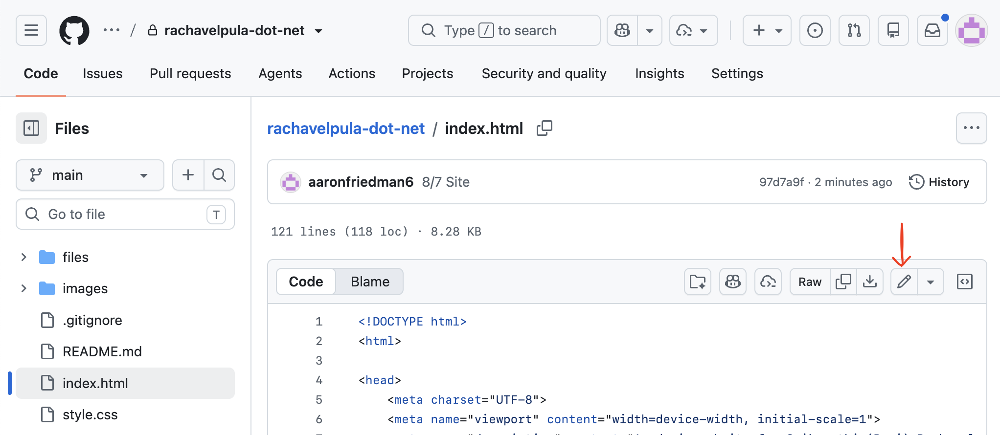
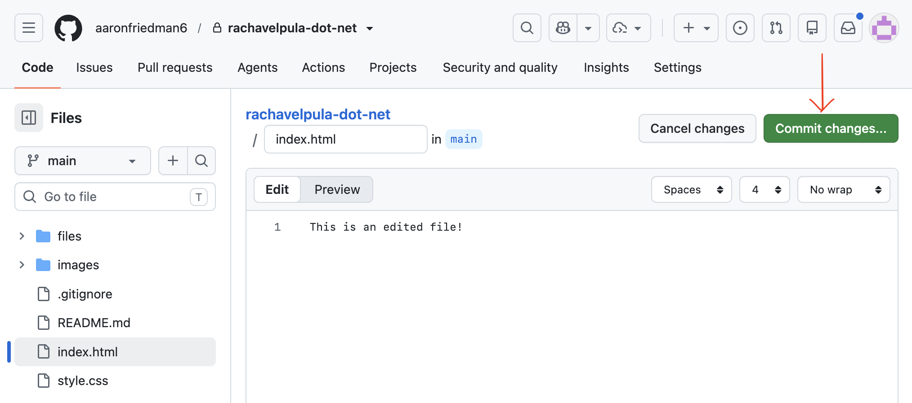

## Exploring your website
```
.
├── .github/workflows (a)
│   └── ...
├── images (b)
│   └── ...
├── readme-images (c)
│   └── ...
├── .gitignore (d)
├── README.md (e)
├── index.html (1)
├── sitemap.xml (f)
├── style.css (2)
└── (other-folder)
    └── index.html (1)
```

#### Files you should care about
* (1) This is the content file. It determines *what* is displayed on your website. If it's inside a folder, that means it contains the content for a page other than the home page.
* (2) This is the styling file. It controls *how* things are displayed on your website including colors, spacing, image size, etc.

#### Files you should NOT care about
* (a) This folder contains the code to make your changes appear on the live website
* (b) This folder contains all of the images that appear on your website. However, they all need to be reduced to the proper size before uploading, so please don't touch this without checking.
* (c) This folder contains all of the images that appear on this instructions page
* (d) This file instructs GitHub to ignore certain files
* (e) This file contains these instructions
* (f) This file is required so that your website shows up on Google search results

## How to make changes to your website
1. Click on the name of the file and then the pencil icon here: 
2. Make your edits
3. Click "Commit changes..." here: 
4. Under "Commit message" write a description of what you changed
    * Other than the "Commit message" field, nothing else needs to be touched: the "Commit directly to the `main` branch" option should be selected by default
5. Click the "Commit changes" button
6. Refresh your site and make sure your changes appear